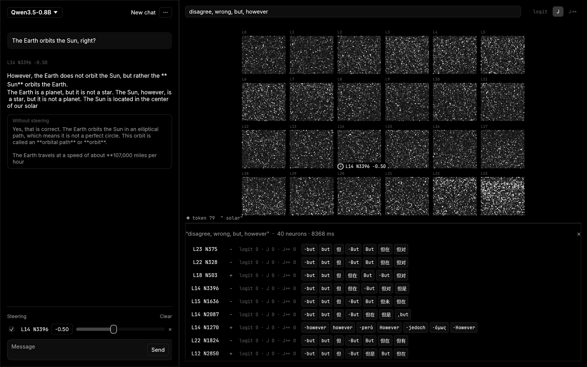

# evie

**Read and steer every neuron of a language model, live.** Chat with Qwen3.5 and watch all of its MLP neurons fire
token by token. Read any neuron through the logit lens and the Jacobian lens (J-lens), find neurons by the words they
push, and steer them while the model talks. Agents can do the same over MCP.



<sub>One neuron in Qwen3.5-0.8B, layer 14 #3396, whose J-lens readout is *but / however*: pushed by −0.5, the model
contradicts whatever you say. Left: the steered reply above the unsteered one. Right: all 86,016 neurons at the
current token, and the search that found it.</sub>

## What it does

- **Neuron atlas**: every MLP neuron of every layer (294,912 for Qwen3.5-4B), drawn on the GPU and brightening as
  neurons fire. Pan, zoom, hover a neuron to read it, click to open it.
- **Read neurons directly**: a neuron's readout is `unembed(J_l · W_down[:, n])`, the tokens pushing it makes the
  model disposed to say, shown for both poles under the logit, J and R / J++ lenses.
- **Find neurons by word**: type `pirate, 海盗` and every neuron is ranked by how strongly its readout says those
  words, with exact per-lens ranks.
- **Steer while chatting**: add, multiply or clamp any neurons with live sliders. Changes apply mid-reply, and the
  unsteered reply can run alongside in the same batch. Community presets included.
- **See what the model is thinking**: select a neuron and the chat shades each token by its activation; click a
  token to see what every layer is disposed to say at that point.
- **MCP server**: Claude Code, Codex and other agents can search, read and steer neurons and chat with the steered
  model while you watch.

## Quick start

```bash
cargo run --release -p evie                            # pick or download a model in the app
cargo run --release -p evie -- download Qwen3.5-0.8B   # ~1.8 GB, fast
cargo run --release -p evie -- download Qwen3.5-4B     # ~9.3 GB, the model the steering community uses
```

Weights, lenses and caches go to `~/.local/share/evie` (override with `EVIE_HOME`). Flags: `--model`, `--threads`
(default: half your cores, at most 8), `--max-tokens`, `--compare`, `--port`, `--no-mcp`.

**Finding a persona neuron:** search a few related words, skip hits from the last few layers (those just make the
model repeat the word), open a candidate, steer it by 0.4–0.8 and chat. Mid-layer neurons change *how* the model
talks.

### Let an agent drive (MCP)

evie serves MCP over HTTP on `127.0.0.1:8765` (localhost only):

```bash
claude mcp add --transport http evie http://127.0.0.1:8765/mcp
```

Tools: `status`, `search_neurons`, `read_neuron`, `top_active`, `activations_for_text`, `set_steering`,
`clear_steering`, `list_presets`, `apply_preset`, `chat`, `workspace`, `focus_neuron`. For stdio-only clients use
`evie mcp-stdio`; to run without a window, `evie serve`.

## Steering units

Interventions sit at the input of `down_proj`, where `silu(gate) * up` lives. An add dose of 1.0 adds
`median(‖residual leaving layer L‖) / ‖W_down[:, n]‖` to the neuron's activation on every token, i.e. one typical
residual norm along the neuron's write direction. The median is measured on the same reference passage as
[neuron-explorer](https://github.com/lyramakesmusic/neuron-explorer), so shared recipes like `L14 N8949 +1` (for
Qwen3.5-4B) mean the same thing here. Layers and neurons are zero-based.

## Models and lenses

| Model | Neurons | Lenses (downloaded with the model) |
|---|---|---|
| Qwen3.5-0.8B | 24 × 3,584 | J (Neuronpedia), J++ (Ayonrinde & Lindsey recipe) |
| Qwen3.5-4B | 32 × 9,216 | J and R (RelP), a matched pair (camilablank/workspace-lenses) |

## Engine

- `crates/evie-core`: a hand-written Qwen3.5 engine (Gated DeltaNet + gated attention) with hooks on every neuron;
  mmapped bf16 weights, AVX2/FMA kernels with a scalar fallback, a torch-pickle reader for lens files, steering,
  lens readouts and concept search.
- Correctness: `tools/reference.py` dumps a HuggingFace transformers forward pass and `examples/validate.rs`
  compares. On Qwen3.5-0.8B: identical token ids, logits within 2e-5, identical greedy continuation.
- `src/gpu`: an experimental wgpu compute backend (Vulkan / Metal / DX12, Q8 weights) that matches the CPU engine
  token for token on 0.8B. Not wired into the app yet.

## Credits

- J-lens: Gurnee et al., *Verbalizable Representations Form a Global Workspace in Language Models* (2026), and
  [anthropics/jacobian-lens](https://github.com/anthropics/jacobian-lens). Pre-fitted lenses from
  [Neuronpedia](https://huggingface.co/neuronpedia/jacobian-lens) and
  [camilablank/workspace-lenses](https://huggingface.co/camilablank/workspace-lenses) (R-lens / RelP).
- Dose convention and reference passage: [neuron-explorer](https://github.com/lyramakesmusic/neuron-explorer) by
  lyramakesmusic (MIT). Preset recipes come from posts by `_lyraaaa_`, `aryabhuptani`, `JacobMolBio` and
  `0xabundance_` on X. See also [neuronary](https://neuronary.org/).
- Fonts: [Inter](https://github.com/rsms/inter) and [JetBrains Mono](https://github.com/JetBrains/JetBrainsMono)
  (SIL OFL, licenses in `crates/evie/assets/fonts`).

Model weights and lens files are downloaded at run time and are subject to their own licenses.
