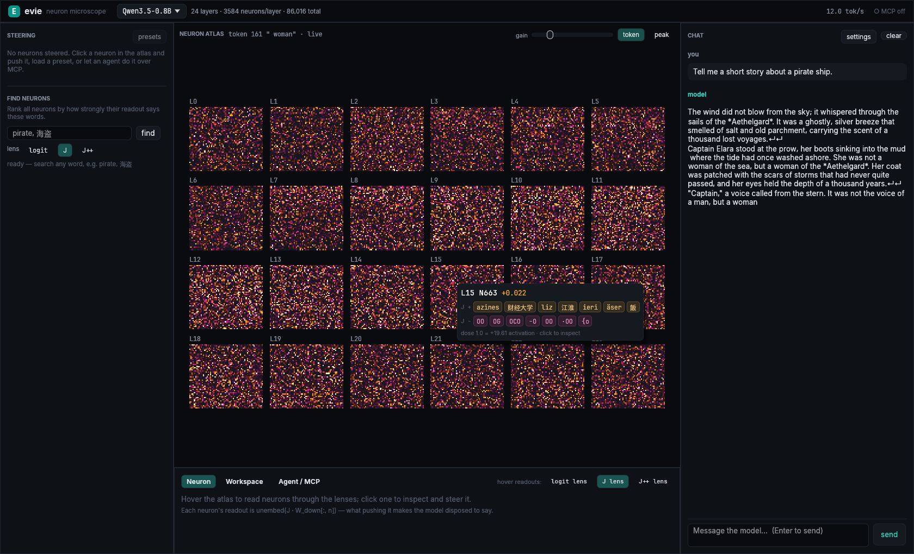
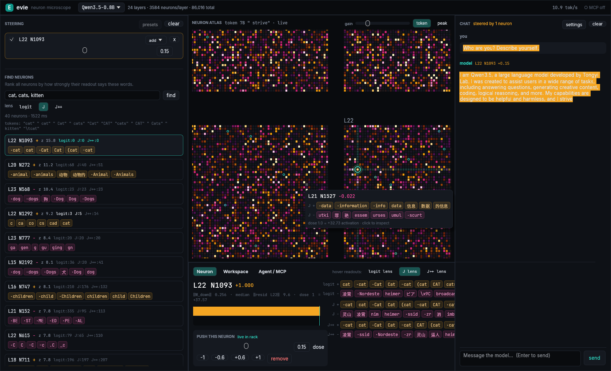

# evie

**A neuron microscope for Qwen3.5.** Chat with the model and watch all of its MLP neurons fire, token by token. Read any
neuron directly through the logit lens, the Jacobian lens (J-lens) and the R-lens. Steer neurons live with the dose
convention the neuron-steering community uses, and let an AI agent do the same over MCP.

Native Rust: a hand-written Qwen3.5 engine (Gated DeltaNet + gated attention) with hooks on every neuron, and a
GPU-rendered egui interface.



## What it does

- **Neuron atlas**: every MLP neuron of every layer (294,912 for Qwen3.5-4B, 86,016 for 0.8B) drawn by a fragment
  shader from one activation texture per token. It animates while the model writes. Pan, zoom, hover to read, click to
  inspect.
- **Streaming chat**: replies stream token by token. Select a neuron and every token is tinted by its activation.
  Hover a token to see the whole model's state at that token.
- **Read neurons directly**: a neuron's readout is `unembed(J_l · W_down[:, n])`, the tokens pushing it makes the
  model disposed to say, shown for both poles under every installed lens.
- **Find neurons by concept**: type words (`pirate, 海盗`) and every neuron is ranked by the standardized logit of
  those tokens in its readout (about 0.5 s for all 295k neurons), with exact per-lens ranks.
- **Steer**: add / multiply / clamp any set of neurons from a rack of live sliders. Changes apply between tokens,
  mid-reply. Compare mode generates the unsteered reply in the same batch. Includes community presets and gated
  interventions (fire only after a detector neuron trips).
- **Workspace view**: what the residual stream at a token is disposed to say, layer by layer, through each lens.
- **MCP server**: agents (Claude Code, Codex, …) can search, read and steer neurons and chat with the steered model
  while you watch in the GUI.



## Quick start

```bash
cargo run --release -p evie               # opens the app; download a model from the start screen
# or fetch first:
cargo run --release -p evie -- download Qwen3.5-0.8B   # ~1.8 GB, fast
cargo run --release -p evie -- download Qwen3.5-4B     # ~9.3 GB, the community's model
```

Weights, lenses and caches go to `~/.local/share/evie` (override with `EVIE_HOME`). Useful flags: `--model`,
`--threads` (default: half your cores, at most 8), `--max-tokens`, `--port`, `--no-mcp`.

### Connect an agent (MCP)

evie serves MCP over HTTP on `127.0.0.1:8765` (localhost only):

```bash
claude mcp add --transport http evie http://127.0.0.1:8765/mcp
```

Tools: `status`, `search_neurons`, `read_neuron`, `top_active`, `activations_for_text`, `set_steering`,
`clear_steering`, `list_presets`, `apply_preset`, `chat`, `workspace`, `focus_neuron`. For stdio-only clients:
`evie mcp-stdio`. Headless (no window): `evie serve`.

## Steering units

Interventions sit at the input of `down_proj`, where `silu(gate) * up` lives. An **add** dose of 1.0 adds
`median(‖residual leaving layer L‖) / ‖W_down[:, n]‖` to the neuron's activation on every token, i.e. one typical
residual norm along the neuron's write direction. The median is measured on the same reference passage as
[neuron-explorer](https://github.com/lyramakesmusic/neuron-explorer), so shared recipes like `L14 N8949 +1` mean the
same thing here. Layers and neurons are zero-based.

## Models and lenses

| Model | Neurons | Lenses (downloaded with the model) |
|---|---|---|
| Qwen3.5-0.8B | 24 × 3,584 | J (Neuronpedia), J++ (Ayonrinde & Lindsey recipe) |
| Qwen3.5-4B | 32 × 9,216 | J and R (RelP), a matched pair (camilablank/workspace-lenses) |

## Engine

- `crates/evie-core`: safetensors via mmap (zero-copy bf16), AVX2/FMA kernels with a scalar fallback, a minimal
  torch-pickle reader for lens files, the steering plan, lens readouts and concept search.
- Correctness: `tools/reference.py` dumps a HuggingFace transformers forward pass; `examples/validate.rs` compares.
  On Qwen3.5-0.8B: identical token ids, logits within 2e-5, identical greedy continuation.
- `src/gpu`: an experimental wgpu compute backend (Vulkan / Metal / DX12, Q8 weights) that matches the CPU engine
  token for token on 0.8B. It is not wired into the app yet.

## Credits

- J-lens: Gurnee et al., *Verbalizable Representations Form a Global Workspace in Language Models* (2026), and
  [anthropics/jacobian-lens](https://github.com/anthropics/jacobian-lens). Pre-fitted lenses from
  [Neuronpedia](https://huggingface.co/neuronpedia/jacobian-lens) and
  [camilablank/workspace-lenses](https://huggingface.co/camilablank/workspace-lenses) (R-lens / RelP).
- Dose convention and reference passage: [neuron-explorer](https://github.com/lyramakesmusic/neuron-explorer) by
  lyramakesmusic (MIT). Community recipes in the presets come from posts by `_lyraaaa_`, `aryabhuptani`,
  `JacobMolBio` and `0xabundance_` on X. See also [neuronary](https://neuronary.org/).
- Fonts: [Inter](https://github.com/rsms/inter) and [JetBrains Mono](https://github.com/JetBrains/JetBrainsMono)
  (SIL OFL, licenses in `crates/evie/assets/fonts`).

Model weights and lens files are downloaded at run time and are subject to their own licenses.
